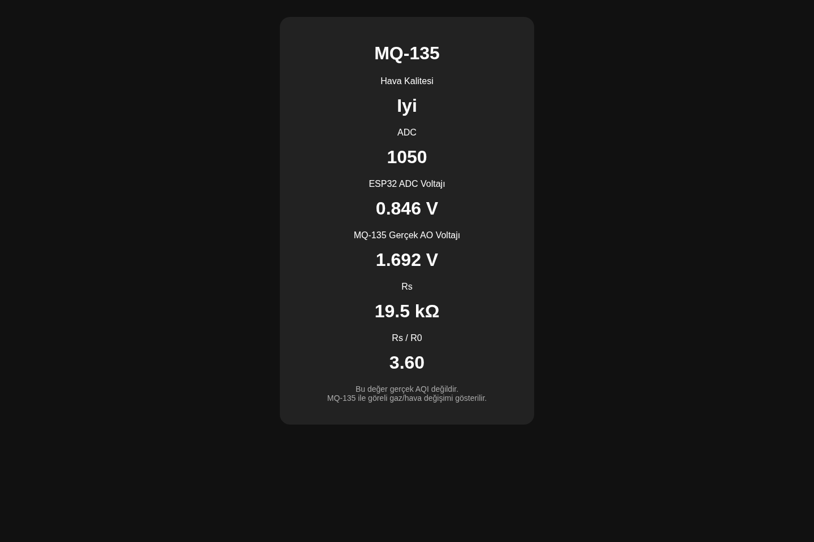
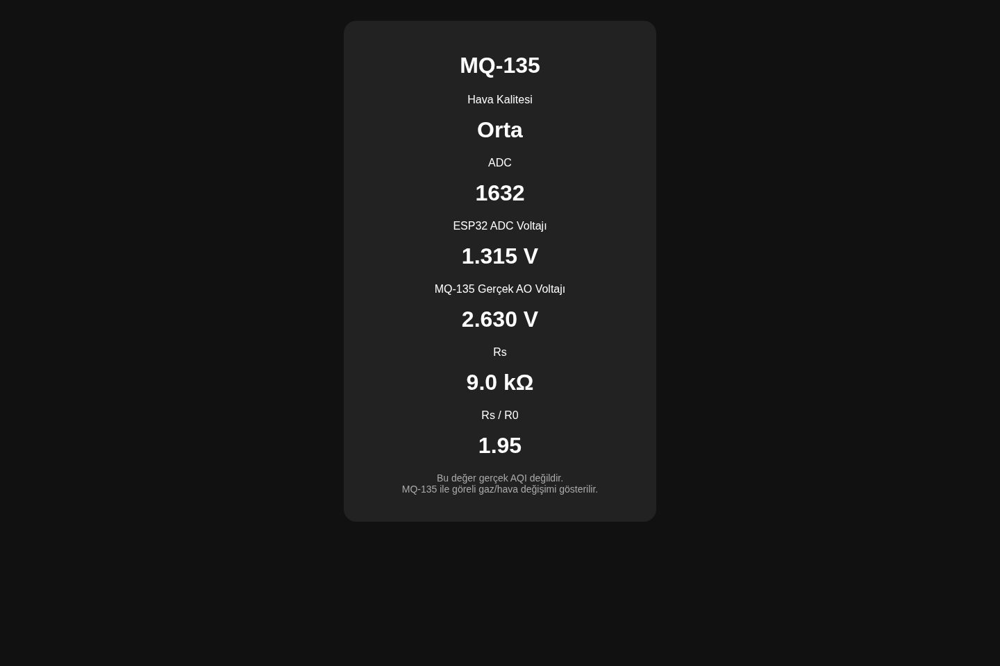

# MQ135 Air Quality Monitor

A simple ESP32 and MQ-135 sensor project that hosts a small web interface for relative air-quality readings.

## Hardware

- ESP32 development board
- MQ-135 gas sensor module
- A voltage divider for the analog output

## Setup

1. Open `mq135-air-quality-monitor.ino` in the Arduino IDE.
2. Set your own `ssid` and `password` values in the sketch.
3. Select an ESP32 board and upload the sketch.
4. Connect to the ESP32 access point and open the IP address printed in the Serial Monitor.

The displayed categories are relative classifications, not certified AQI measurements.

## Status

Simple experimental project.

<!-- project-screenshot-gallery:start -->
## Screenshots

The web interface is shown with two example sensor readings.

  
  

<!-- project-screenshot-gallery:end -->
